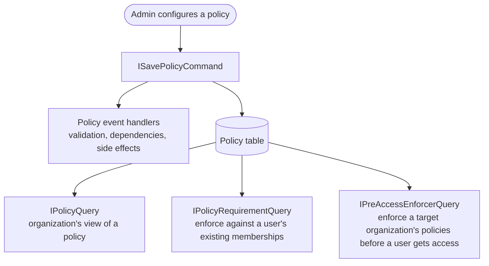

# Organization Policies

## Purpose

This directory contains the server-side policies domain: how organization policies are configured, stored and enforced.
This README gives a high-level overview of the domain. Implementation details are documented in the READMEs of the
relevant sub-folders.

## Key concepts

### What is a policy?

A policy is a setting that an organization admin turns on to govern the behavior of the organization's members, or to change
how the organization itself behaves. For example:

- "All members must log in with SSO" (`RequireSso`)
- "Members must have two-step login enabled" (`TwoFactorAuthentication`)
- "Members cannot belong to any other organization" (`SingleOrg`)
- "Members cannot create Sends" (`SendControls`)
- "Master passwords must meet these complexity requirements" (`MasterPassword`)

An organization has at most one policy of each `PolicyType`. A policy has an `Enabled` flag and optional JSON `Data` for
policy-specific configuration (e.g. the minimum password length). Policies are only available to organizations whose plan
includes `UsePolicies` (generally enterprise only).

### Enabled does not mean enforced

A policy being enabled does not mean that it applies to every member. The domain has business rules that determine whether
a policy is enforced against a particular user.

The domain intentionally uses words like "applied" or "enforced" to indicate that a policy should affect a specific member,
rather than a policy merely being "enabled".

Policy enforcement generally depends on:

- The user's role - Owners and Admins are exempt by default (but some policies override this).
- The user's status - Staged, Invited and Revoked users are exempt by default.
- Whether the user is a Provider user managing the organization - Providers are exempt by default.

Individual policies can change these defaults. A user can also belong to several organizations, each with its own policies,
so the policies that apply to them must be combined into a single answer.

For these reasons, code outside this domain should never read the `Policy` entity directly to make an enforcement decision.
Instead, use the higher level queries described below.

### Ownership

The foundational rule of the policy domain is that **core logic is policy-agnostic**. Policies span many different
business domains and teams; the policy domain must serve all of them equally, without accumulating ad-hoc customizations
for every new policy.

Additionally, policies can only have an effect if actually read and acted upon somewhere else in the code - usually
by the feature that the policy relates to.

Therefore:

- The Admin Console Team builds and maintains the core policy framework. This provides the general capability for
  defining new policies, but not any specific policy.
- Other teams use this framework to define how their policies are validated and enforced.

## Usage

> _Audience: engineers working with policies for the first time. Intent: which entry point to use for writing, reading
> and enforcing policies. Scope: entry points in this directory only; omits repositories, sync and API controllers._

### Administration

`ISavePolicyCommand` is the single entry point for creating or updating a policy. It validates the change, runs any side
effects, saves the policy and logs an event.

Policies hook into this workflow by implementing policy update event interfaces. For example, a policy can require another
policy to be enabled first, or revoke non-compliant members when it is turned on. Policies that need no special behavior
need no handler at all. Handlers live in `PolicyEventHandlers/`.

See [the policy save workflow](PolicyUpdateEvents/README.md).

### Reading organization state

`IPolicyQuery` returns a `PolicyStatus`: an organization's configuration of a policy type, whether or not a policy has been
saved. Use it for administrative and organization-level views. It applies no user-level business rules, so it is not
suitable for enforcement.

### Enforcement against members

`IPolicyRequirementQuery` answers "how do policies affect this user?" It fetches the policies from every organization the
user belongs to, filters out those that should not be enforced, and combines the rest into an `IPolicyRequirement`. A policy
requirement describes the effect of the policy in terms that make sense to the consuming feature, e.g. `DisableSend` rather
than `Enabled`.

Each requirement has a factory that defines its filtering and combining rules. This keeps the business rules in one place,
so consumers do not need to repeat them.

**Note:** `IPolicyRequirementQuery` never returns `Staged` memberships, so a requirement cannot opt in to enforcing
against `Staged` users by changing `ExemptStatuses`.

See [policy requirements](PolicyRequirements/README.md).

### Pre-access enforcement

Some flows need to check a target organization's policies against a user who is about to be given access to it. The user
may not have an active membership yet, so the normal requirement query cannot answer the question. See
[enforcing policies before gaining access](#enforcing-policies-before-gaining-access).

`IPreAccessEnforcerQuery` loads the target organization's policies and returns an `IPreAccessPolicyEnforcer`, which evaluates
them against the role the user will hold. It reuses the role and provider exemptions defined by the policy requirement
factories (`IPreAccessPolicyRequirementFactory`), so the rules are consistent with ordinary enforcement. It only covers the
target organization; use `IPolicyRequirementQuery` for policies from organizations the user already belongs to.

## Gotchas / constraints

### Client and server enforcement

Clients receive policies through sync and enforce many of them locally. There are two use cases for this:

1. The policy can be enforced by the server, but the UI needs to be updated to communicate this to the user
   (for example, hiding a feature that the policy disables).
2. The policy cannot be enforced by the server, because it is entirely client-side. This is why some `PolicyType`s have
   no server-side requirement or event handler. In some cases the server still combines the user's policies and returns
   the result to the client. For example, the Master Password cannot be read by the server, so only the client can
   enforce complexity requirements, but the server calculates the requirements that apply to the user.

**If the policy can be enforced by the server, it should be.** Never rely on simply hiding something in the UI.

### Enforcing policies before gaining access

There are two broad situations when policies are enforced:

1. During normal application use.
2. As a precondition to gaining access to an organization. This includes accepting an organization invite, being
   confirmed by an admin, or being restored from a revoked status. This is called "pre-access" enforcement.

Pre-access enforcement checks whether the user _would_ comply once the status change is made. The user's current status
in the target organization is irrelevant, so status exemptions are not applied; only role and provider exemptions are.
This is the special case that `IPreAccessEnforcerQuery` addresses. By contrast, `IPolicyRequirementQuery` enforces
policies against the user's current memberships, with all exemptions applied.

A pre-access flow may need both queries: `IPreAccessEnforcerQuery` for the target organization's policies, and
`IPolicyRequirementQuery` for the policies of organizations the user already belongs to, if that could affect
the flow (e.g. another organization's `SingleOrg` policy may prevent the user from joining).
