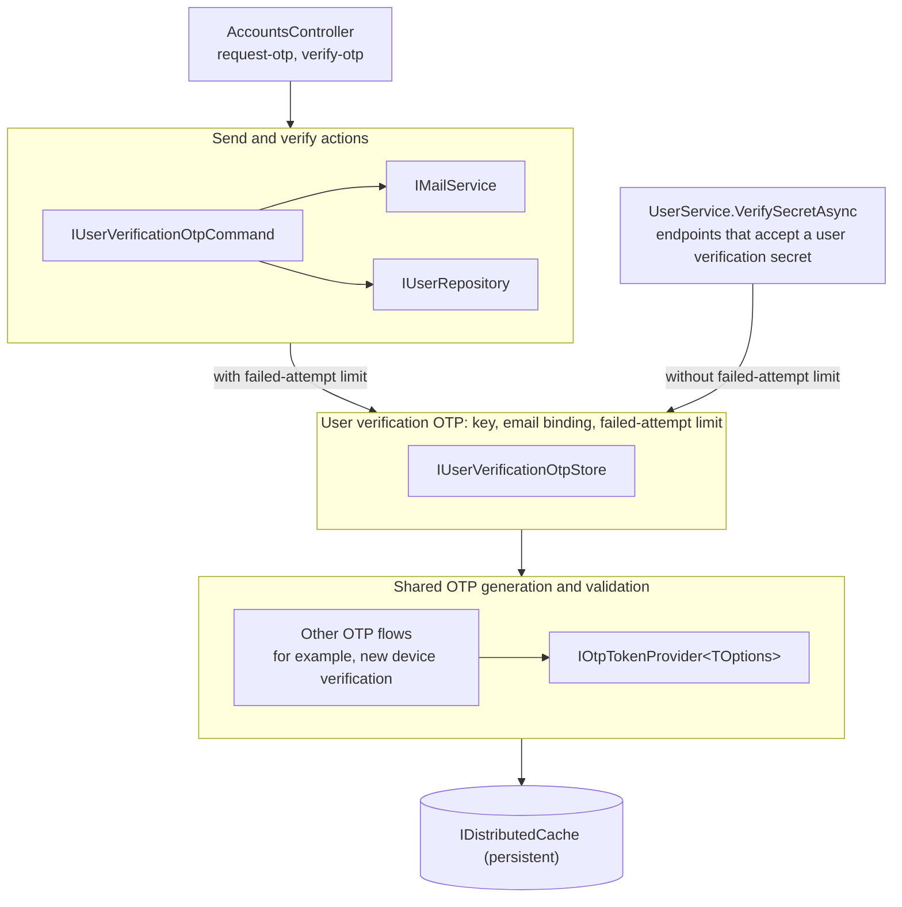

# User Verification via OTP

This area covers the one-time password (OTP) that the server emails to a user to prove that the user controls
the mailbox at their account email. Clients request the OTP through `POST /accounts/request-otp`. Users then
submit it to `POST /accounts/verify-otp`, or to an endpoint that accepts a user verification secret (a master
password hash or this OTP) before a sensitive action.

## Terms

Each verb has one meaning across the layers:

| Term           | Meaning                                                                                                 |
| -------------- | ------------------------------------------------------------------------------------------------------- |
| Generate       | `IOtpTokenProvider<TOptions>` creates a random code and stores it.                                      |
| Issue          | `IUserVerificationOtpStore` has `IOtpTokenProvider<TOptions>` create a code for the user. The new code replaces any pending one. |
| Send           | `IUserVerificationOtpCommand` issues a code and emails it.                                              |
| Validate       | `IOtpTokenProvider<TOptions>` and `IUserVerificationOtpStore` check a code, and remove it after a correct one. |
| Verify         | `IUserVerificationOtpCommand` validates a code and marks the user's email as verified.                  |
| Failed attempt | A validation with a wrong OTP or a mismatched bound value.                                              |

## Architecture

Each layer knows less than the layer above it. Only the bottom layer reads and writes the OTP in the cache.

### `IUserVerificationOtpCommand`: send and verify actions

[`IUserVerificationOtpCommand.cs`](./IUserVerificationOtpCommand.cs)

**Why a separate layer:** it holds what `request-otp` and `verify-otp` do with the OTP: the email, the error
messages, and setting `EmailVerified`. Other callers check the same OTP but must not send mail or change the
account. This is the only layer that sends mail or writes to the database.

1. `SendOtpAsync` checks that the user has an email, issues an OTP through `IUserVerificationOtpStore`, and
   emails it. It throws a `BadRequestException` when the user has no email.
2. `VerifyOtpAsync` validates through `IUserVerificationOtpStore` with the failed-attempt limit. A valid OTP sets
   `User.EmailVerified` and saves the user.

### `IUserVerificationOtpStore`: user verification OTP key, email binding, and failed-attempt limit

[`src/Core/Auth/Services/IUserVerificationOtpStore.cs`](../../Services/IUserVerificationOtpStore.cs)

**Why a separate layer:** it holds every rule for this one kind of OTP. More than one caller checks the same
OTP, so the rules live here once and the callers cannot drift apart.

1. **One OTP for every action:** each user has at most one pending emailed OTP, and it is not tied to the
   action that requested it. A code requested for one action is accepted by `verify-otp` and by every endpoint
   that accepts a user verification secret. The failed-attempt count also belongs to the code, not to an action.
   1. In the future, consider whether each action should have its own emailed OTP, with a distinct purpose.
2. **Key:** the unique identifier is `{userId}_{securityStamp}`, so a security stamp change invalidates a
   pending OTP.
3. **Email binding:** the OTP is bound to `User.Email`. It proves control of the address it was sent to, so it
   must not validate after the address changes, even when the security stamp does not change.
4. **Failed-attempt limit:** 5 failed attempts for each OTP through `ValidateAndConsumeWithFailureLimitAsync`.
   The limit is on each OTP, not on the user, so it does not limit how many OTPs a user can request.
5. **Options:** `IUserVerificationOtpStore` uses `DefaultOtpTokenProviderOptions`, which other OTP flows share.
   To change the code length, character set, or expiry of this OTP only, give it its own `TOptions` class.
6. **Callers:** both callers check the same OTP, and each chooses a validate method:
   1. `IUserVerificationOtpCommand` uses `ValidateAndConsumeWithFailureLimitAsync`.
   2. `UserService.VerifySecretAsync` uses `ValidateAndConsumeAsync`, which does not count failed attempts.

### `IOtpTokenProvider<TOptions>`: shared OTP generation and validation

[`src/Core/Auth/Identity/TokenProviders/OtpTokenProvider/`](../../Identity/TokenProviders/OtpTokenProvider/readme.md)

**Why a separate layer:** it holds the mechanics that every kind of OTP shares, and no rules for any one flow.
Other OTP flows use it with their own rules, so a fix here helps every flow, and one flow's rules cannot affect
another.

1. Generates a secure random code and stores it under `{tokenProviderName}_{purpose}_{uniqueIdentifier}`, with
   a 5-minute expiry by default.
2. Validates a code with a fixed-time comparison, checks its bound value, and removes it after a correct guess.
3. `ValidateTokenWithFailureLimitAsync` also counts failed attempts and removes the code at a limit that the
   caller sets.
