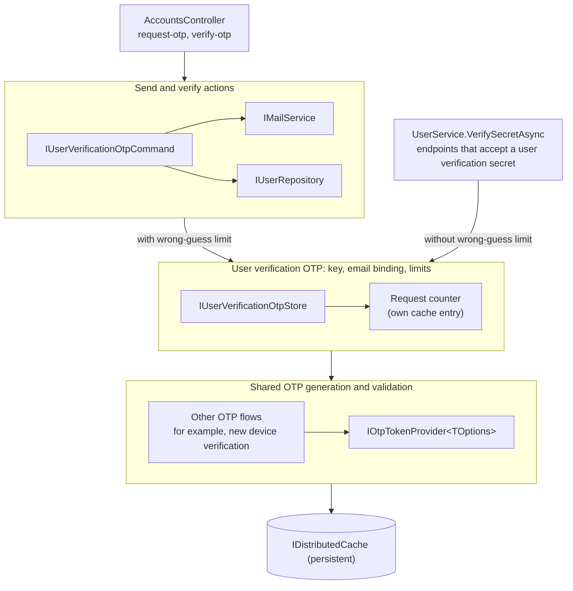

# User Verification OTP

This area covers the one-time password (OTP) that the server emails to a user to prove that the user controls
the mailbox at their account email. Clients request the OTP through `POST /accounts/request-otp`. Users then
submit it to `POST /accounts/verify-otp`, or to an endpoint that accepts a user verification secret (a master
password hash or this OTP) before a sensitive action.

## Architecture

Each layer knows less than the layer above it. Only the bottom layer reads and writes the OTP in the cache.

### `IOtpTokenProvider<TOptions>`: shared OTP generation and validation

[`src/Core/Auth/Identity/TokenProviders/OtpTokenProvider/`](../../Identity/TokenProviders/OtpTokenProvider/readme.md)

1. Generates a random code and stores it in the cache under `{tokenProviderName}_{purpose}_{uniqueIdentifier}`,
   with a 5-minute expiry by default.
2. Validates a code, binds a code to a value, and removes a code after a correct guess.
3. `ValidateTokenWithFailureLimitAsync` also counts wrong guesses and removes the code at a limit that the
   caller sets.
4. Does not know about users, email, or the purpose of a code.

### `IUserVerificationOtpStore`: user verification OTP key, email binding, and limits

[`src/Core/Auth/Services/IUserVerificationOtpStore.cs`](../../Services/IUserVerificationOtpStore.cs)

1. Sets the key parts. The unique identifier is `{userId}_{securityStamp}`, so a security stamp change
   invalidates a pending OTP.
2. Binds the OTP to `User.Email`, so an email change invalidates a pending OTP.
3. Sets the limits: 5 wrong guesses for each OTP, and 5 issued OTPs for each user in a fixed 15-minute window.
   The request counter is a separate cache entry that the store writes directly, because the provider manages
   codes, not counters.
4. Knows `User`, but does not send mail or write to the database.

### `IUserVerificationOtpCommand`: send and verify actions

[`IUserVerificationOtpCommand.cs`](./IUserVerificationOtpCommand.cs)

This is the only layer that sends mail or writes to the database.

1. `SendOtpAsync` checks that the user has an email, issues an OTP through the store, and emails it. It throws
   a `BadRequestException` when the user has no email or has reached the request limit.
2. `VerifyOtpAsync` validates through the store with the wrong-guess limit. A valid OTP sets
   `User.EmailVerified` and saves the user.

## Why the store is separate from the command

`UserService.VerifySecretAsync` must validate the same OTP that `request-otp` sends, but it must not set
`EmailVerified` or send mail. The store holds the key, binding, and limits in one place, so both callers check
the same OTP. Each caller chooses a validate method on the store:

1. The command uses `ValidateAndConsumeWithFailureLimitAsync`.
2. `UserService.VerifySecretAsync` uses `ValidateAndConsumeAsync`, which does not count wrong guesses.

The command depends on the store, and `UserService` depends on the store. The command does not depend on
`IUserService`, so the dependency graph has no cycle.
